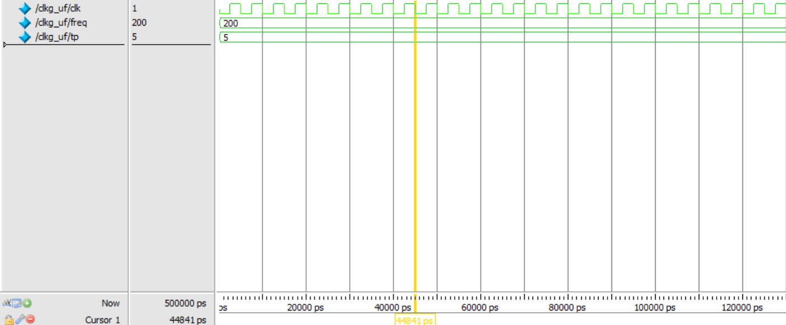

# User-Defined Clock Generation using Verilog HDL

## 1. Project Overview

This project demonstrates the generation of a user-defined clock signal using Verilog HDL. The clock frequency is provided dynamically during simulation using the `$value$plusargs` system task.

The design automatically calculates the clock time period based on the input frequency and generates a continuous clock waveform with a 50% duty cycle.

The project is developed using GVim and simulated using ModelSim 2020.1.

## 2. Tools and Technologies

- **Hardware Description Language:** Verilog HDL
- **Simulation Tool:** ModelSim 2020.1
- **Code Editor:** GVim
- **Simulation Automation:** ModelSim DO Script

## 3. Project Files

| File Name | Description |
|---|---|
| `clkg_uf.v` | Verilog source code for user-defined clock generation |
| `run.do` | ModelSim automation script |
| `Waveform.png` | Generated clock simulation waveform |
| `README.md` | Project documentation |

## 4. Working Principle

1. The user provides the desired clock frequency through a simulation command-line argument.
2. The `$value$plusargs` system task reads the input frequency.
3. The clock time period is calculated based on the input frequency.
4. The clock signal is initialized to logic 0.
5. A `forever` loop continuously toggles the clock after every half-period delay.
6. The simulation terminates after 500 ns using the `$finish` system task.

## 5. Clock Period Calculation

The clock time period is calculated using:

\[
T = \frac{1}{f}
\]

For frequency in MHz and time period in ns:

\[
T(ns) = \frac{1000}{f(MHz)}
\]

### Simulation Parameters

| Parameter | Value |
|---|---:|
| Input Frequency | 200 MHz |
| Clock Time Period | 5 ns |
| Clock High Time | 2.5 ns |
| Clock Low Time | 2.5 ns |
| Duty Cycle | 50% |
| Simulation Duration | 500 ns |

### Calculation

For an input frequency of 200 MHz:

\[
T = \frac{1000}{200} = 5\ ns
\]

For a 50% duty cycle:

\[
T_{HIGH} = \frac{5}{2} = 2.5\ ns
\]

\[
T_{LOW} = \frac{5}{2} = 2.5\ ns
\]

Therefore, the generated clock has a 5 ns time period with equal high and low durations.

## 6. ModelSim Simulation Procedure

The simulation is performed using ModelSim 2020.1.

### Step 1: Compile the Verilog Design

```tcl
vlog clkg_uf.v -l comp.log
```

### Step 2: Elaborate and Load the Design

```tcl
vsim -voptargs=+acc clkg_uf +freq=200
```

### Step 3: Add Signals to the Waveform Window

```tcl
add wave sim:/clkg_uf/*
```

### Step 4: Run the Simulation

```tcl
run -all
```

## 7. Simulation Automation Using run.do

The `run.do` file automates the complete ModelSim simulation process.

It performs the following operations:

- Compilation of the Verilog source file.
- Loading and elaboration of the design.
- Passing the user-defined frequency of 200 MHz.
- Adding design signals to the waveform window.
- Running the simulation until completion.

To execute the complete simulation automatically, enter the following command in the ModelSim Transcript window:

```tcl
do run.do
```

Make sure that `clkg_uf.v` and `run.do` are located in the same working directory.

## 8. Simulation Waveform

The following waveform represents the generated clock signal for an input frequency of **200 MHz**, simulated using ModelSim 2020.1.

<p align="center">
  
</p>
<p align="center">
  <b>Figure 1: ModelSim Simulation Waveform at 200 MHz</b>
</p>

### Waveform Observations

- Input clock frequency: 200 MHz.
- Clock period: 5 ns.
- High duration: 2.5 ns.
- Low duration: 2.5 ns.
- Duty cycle: 50%.
- The clock signal continuously toggles between logic 0 and logic 1.

The simulation waveform verifies the successful generation of a user-defined clock signal using Verilog HDL.

## 9. Verilog Concepts Used

- Initial procedural block
- `$value$plusargs` system task
- `forever` loop
- Delay control
- Runtime parameter passing
- Clock signal generation
- `$finish` system task

## 10. Learning Outcomes

- Understanding user-defined clock generation using Verilog HDL.
- Learning runtime parameter passing using `$value$plusargs`.
- Calculating clock time period from input frequency.
- Implementing continuous clock generation using procedural blocks.
- Automating simulation using ModelSim DO scripts.
- Verifying clock characteristics through waveform analysis.

## 11. Author

M.Tech VLSI Design Student

